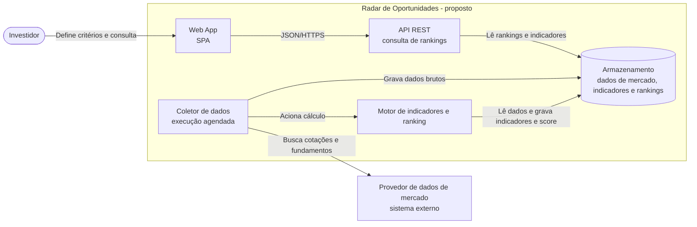
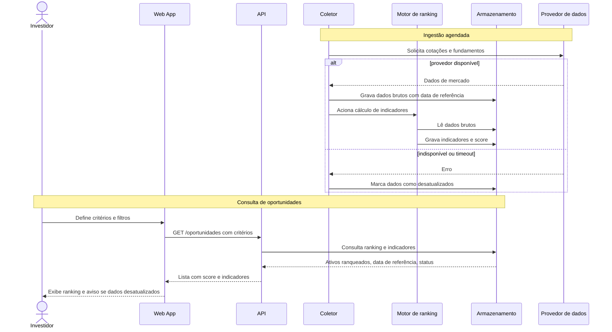

# Radar de Oportunidades — Documentação de Arquitetura

Projeto acadêmico de **discovery de documentação** (Unidade III) usando _diagrams as code_ com Mermaid e apoio de GenAI. Descreve uma **arquitetura proposta**, não uma implementação existente. Não constitui recomendação de investimento.

## Estrutura

- `README.md` — descrição, diagramas e decisões
- `docs/descricao.md` — descrição em linguagem natural (fonte usada nos prompts)
- `docs/prompts.md` — prompts usados na geração
- `docs/diagrams/*.mmd` — fontes dos diagramas
- `AGENTS.md` — contexto para agentes de desenvolvimento

## 1. Descrição do sistema

**Visão geral:** sistema que coleta dados de ativos da bolsa de valores, calcula indicadores fundamentalistas e de mercado e apresenta um ranking explicável de oportunidades conforme critérios definidos pelo investidor. É uma ferramenta de triagem, não uma recomendação de investimento.

**Escopo:** ingestão periódica de dados, cálculo de indicadores, score e ranking explicável, consulta com filtros e indicação de dados desatualizados. **Fora de escopo:** execução de ordens, integração com corretoras, gestão de carteira, backtesting, derivativos, recomendações personalizadas e autenticação. Mercado de referência (hipótese): ações da B3.

**Nível da visão:** diagrama estrutural inspirado no nível de containers do C4, sem detalhar classes, tabelas ou endpoints; diagrama de sequência para a jornada de ingestão e consulta.

**Limites e responsabilidades:**

| Componente                     | Responsabilidade                                                 |
| ------------------------------ | ---------------------------------------------------------------- |
| Web App                        | Capturar critérios e exibir ranking, indicadores e avisos        |
| API REST                       | Servir rankings e indicadores já calculados                      |
| Coletor de dados               | Buscar dados no provedor de forma agendada e persistir           |
| Motor de indicadores e ranking | Calcular indicadores e score; manter a lógica de ranking isolada |
| Armazenamento                  | Manter dados brutos, indicadores, rankings e data de referência  |

**Integrações:** provedor de dados de mercado (sistema externo), consultado pelo Coletor para cotações, fundamentos e proventos.

**Indicadores de exemplo (a definir):** P/L, P/VP, Dividend Yield, ROE, Dívida líquida/EBITDA, margem líquida e liquidez média diária.

**Restrições:**

- Resultado é apoio à análise, com aviso de que não é recomendação de investimento.
- Dados podem ter defasagem; a data de referência deve ser sempre exibida.
- O score deve ser explicável, mostrando quais indicadores contribuíram.
- Uso dos dados sujeito à licença do provedor.
- Cálculo separado da coleta; processamento assíncrono em relação ao usuário.
  **Lacunas (não são decisões aprovadas):** provedor de dados, licença e periodicidade; definição e pesos do score; comparação por setor (o P/L de um banco não é comparável ao de um varejista); ajustes por proventos, desdobramentos e grupamentos; retenção de histórico; modelo de dados; autenticação; requisitos de desempenho; retries e critérios de aceite.

## 2. Diagrama estrutural — Containers (C4 simplificado)



Fonte: [docs/diagrams/containers.mmd](docs/diagrams/containers.mmd)

## 3. Diagrama comportamental — Ingestão e consulta



Fonte: [docs/diagrams/sequencia.mmd](docs/diagrams/sequencia.mmd)

## 4. Decisões e ajustes sobre o que o modelo gerou

| #   | O que o modelo gerou                         | O que ajustei                                                      | Por quê                                                     |
| --- | -------------------------------------------- | ------------------------------------------------------------------ | ----------------------------------------------------------- |
| 1   | Containers para corretora, ordens e carteira | Removi                                                             | Fora do escopo; o sistema é de triagem                      |
| 2   | Coleta e cálculo no mesmo componente         | Separei Coletor e Motor de ranking                                 | Responsabilidades distintas e lógica de score isolada       |
| 3   | Fila, cache e banco com tecnologia definida  | Removi; deixei como lacuna                                         | Sem requisito que justifique; evitar decisões não aprovadas |
| 4   | Fluxo só do caminho feliz                    | Adicionei alt/else para falha do provedor e estado "desatualizado" | Dado de mercado defasado afeta a confiança do ranking       |
| 5   | Ranking sem explicação                       | Exigi score explicável e exibição da data de referência            | Transparência e rastreabilidade                             |
| 6   | Linguagem de recomendação ("compre")         | Troquei por "oportunidade" e adicionei aviso                       | Não é recomendação de investimento                          |

## 5. Como usar como contexto para agentes

Ver [AGENTS.md](AGENTS.md). Pendências para implementação: provedor de dados, definição e pesos do score, comparação por setor, ajustes por proventos e desdobramentos, modelo de dados, OpenAPI, autenticação, observabilidade e ADRs.

## 6. Como executar

```bash
# backend
python3 -m venv .venv && .venv/bin/pip install -e ".[dev]"
.venv/bin/python -m coletor --once --db radar.db          # coleta + cálculo (provedor mockado)

# API (OpenAPI em http://localhost:8000/docs)
RADAR_DB=radar.db .venv/bin/python -m uvicorn api.main:app --port 8000

# Web App (React): build único e serviço pela API
cd src/webapp && npm install && npm run build && cd ../..
RADAR_DB=radar.db RADAR_WEBAPP_DIR=src/webapp/dist .venv/bin/python -m uvicorn api.main:app --port 8000
# UI em http://localhost:8000 — em desenvolvimento: cd src/webapp && npm run dev (proxy para :8000)

# testes
.venv/bin/python -m pytest          # containers Python
cd src/webapp && npm test           # Web App (Vitest)
```

Decisões em `docs/adr/` (0001 stack, 0002 modelo de dados, 0003 ingestão, 0004 score, 0005 API, 0006 Web App React).
